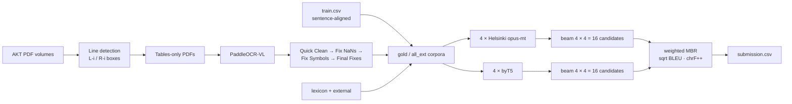

# Deep Past Challenge — Old Assyrian (Akkadian) → English

**Kaggle silver medal · private LB rank 104 / 2,600+ teams** —
[Deep Past Challenge: Translate Akkadian to English](https://www.kaggle.com/competitions/deep-past-initiative-machine-translation)

Four thousand years ago, Assyrian merchants recorded debts, caravans and family matters on clay
tablets. Only about half of the ~23,000 surviving tablets have been translated, and fewer than a
dozen scholars can read the rest. This repository holds the full pipeline behind my solution:

1. **Data mining.** Line-by-line transliteration/translation pairs extracted from the
   *Ankara Kültepe Tabletleri* (AKT) PDF editions with a layout + **PaddleOCR-VL** pipeline.
2. **Eight translation models.** Four Helsinki-NLP opus-mt models trained from their base checkpoints, and
   four byT5 models fine-tuned from the strongest public checkpoints.
3. **A weighted MBR ensemble.** 32 beam candidates per sentence; the final pick maximises the
   competition metric against the rest of the pool. The whole ensemble runs in **under 33 minutes** on Kaggle's 2×T4.

The final ensemble was a **one-shot submission**. Four of the five daily submissions had already been used on the last day,
and the team was ranked ~550. This single ensemble climbed ~400 places into the silver zone and held there on the private leaderboard.

## Solution overview



### 1. AKT PDFs → parallel corpus

`train.csv` alone (~1.5k document-level pairs) was not enough. I spent the first three of my fifteen days
extracting line-aligned pairs from the AKT editions of the Kültepe tablets.
([discussion post](https://www.kaggle.com/competitions/deep-past-initiative-machine-translation/discussion/684249))

* **Detect lines on every page.** Transliteration lines in the left column (red `L-i` boxes) and
  translation lines in the right column (blue `R-i` boxes) are paired by vertical position. Margin line
  numbers (`10`, `15`, `rev.`, `e.`) are kept out of the boxes.
* **Build "tables-only" PDFs.** Each row holds the crop of one transliteration line next to its translation line.
  Crops keep the original typography (italics, `il₅`, `a-limᵏⁱ`, `ᵈA-šùr`).
* **OCR the tables with PaddleOCR-VL.** It recognises a clean table far more reliably than the original two-column
  page, which is where OCRing the raw PDFs failed.
* **Clean the result in four steps:** Quick Clean → Fix NaNs (merge continuation cells) → Fix Symbols (OCR
  confusions, determinatives, the competition's transliteration format) → Final Fixes (filters, de-duplication,
  gold/silver quality tiers).

### 2. Models

| Model | Initialisation | Training data | MBR weight | Max len |
|---|---|---|---|---|
| `helsinki_final` | Helsinki-NLP/opus-mt-ROMANCE-en | gold | 25–27 | 256 |
| `helsinki_5_ep` | early-stopped snapshot of `helsinki_final` | gold | 25–27 | 256 |
| `helsinki_all_ext` | Helsinki-NLP/opus-mt-ROMANCE-en | all external + train | 25–27 | 256 |
| `helsinki_mt_mul` | Helsinki-NLP/opus-mt-mul-en | gold | 25–27 | 256 |
| `byt5_34_4` | public *final-byt5* checkpoint | gold | **35** | 512 |
| `byt5_ext_vocab` | public *final-byt5* checkpoint | all external (vocabulary) | 27–35 | 512 |
| `byt5_matia_orig` | public *mbr v2* checkpoint, used as-is | — | 27–35 | 512 |
| `byt5_matia_base` | public *mbr v2* checkpoint | gold | 27–35 | 512 |

The team joined in the last 15 days, which was not enough time to train byT5-base from scratch, so the byT5 models
start from the best public checkpoints. The smaller, faster Helsinki models were trained from their opus-mt
base checkpoints.

### 3. Weighted Minimum Bayes Risk ensemble

Every model returns 4 beams (`num_beams=4, num_return_sequences=4`), so each test sentence gets
**8 × 4 = 32 candidates**. The selection works like this:

1. **Normalise gap tokens.** `<gap>`, `...`, `[x]`, `x`, `(broken)` etc. become `<gap>` / `<big_gap>`.
2. **Deduplicate.** A unique candidate carries the summed weight of every (model, beam) that produced it.
3. **Score every pair** with the competition metric, sentence-level `sqrt(BLEU · chrF++)`.
4. **Weight by model quality.** Helsinki memorised the training distribution and looked excellent on
   validation, but that did not transfer to the leaderboard. Helsinki therefore gets lower weights
   (25–27) and byT5 higher ones (27–35), to balance memorisation against LB adaptability.
5. **Pick the candidate with the highest expected similarity to the pool:**
   `argmax_c Σ_c' W(c') · sim(c, c')`.

Inference runs concurrently on both Kaggle GPUs (`CUDA_VISIBLE_DEVICES=0` / `1` background processes).
The four Helsinki models take ~8 min and the four byT5 models ~25 min, so the whole ensemble finishes in **< 33 min**.

### 4. Qwen2.5-7B experiment

I also fine-tuned Qwen2.5-7B with unsloth, using a simple prompt similar to the byT5 input. It is included
as an optional pipeline. I left it out of the final ensemble because its leaderboard performance had never
been checked on its own.

## Status

The core library is in place and tested: transliteration/translation normalisation, a sacrebleu-exact
re-implementation of the competition metric, the tokenizer character codec, model loading/generation and config
handling. The AKT/OCR pipeline, preprocessing, training, inference/MBR, the Qwen experiment and the
self-contained Kaggle notebooks are being added next.

```bash
pip install -e ".[train,dev]"
pytest
```

## License

MIT — see [LICENSE](LICENSE). The competition data and the AKT editions are not redistributed here.
